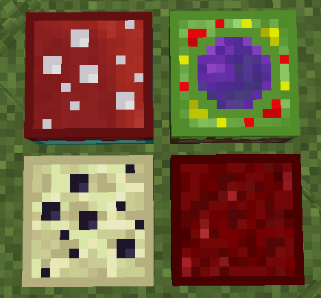

# TelePastries Fabric

<p align="center">
  
</p>

[](https://github.com/Der0Benson/TelePastries-Fabric/actions/workflows/build.yml)
[](LICENSE)

**Inoffizielle Fabric-Portierung von TelePastries für Minecraft 1.21.1.**

> This is an unofficial Fabric port of TelePastries.

TelePastries ergänzt Kuchen, mit denen Spieler sicher zwischen Dimensionen reisen können. Diese Portierung übernimmt Spielmechanik, Texturen, Rezepte, Positionsspeicherung und Konfigurationsmöglichkeiten des Originals so originalgetreu wie möglich für Fabric.

## Voraussetzungen

| Komponente | Version |
| --- | --- |
| Minecraft | **1.21.1** |
| Java | 21 |
| Fabric Loader | 0.19.5 oder neuer |
| Fabric API | 0.116.17+1.21.1 oder kompatibel |

> **Wichtig:** Minecraft 1.21.1 und 1.21.11 sind unterschiedliche Versionen. Diese Mod ist ausschließlich für **1.21.1** gebaut.

## Installation

1. Eine Fabric-Instanz für Minecraft 1.21.1 erstellen.
2. Fabric API für Minecraft 1.21.1 installieren.
3. Die aktuelle JAR aus den [GitHub-Releases](https://github.com/Der0Benson/TelePastries-Fabric/releases) in den Ordner `mods` kopieren.
4. Ältere TelePastries-JARs aus diesem Ordner entfernen.

## Enthaltene Kuchen

- Nether-Kuchen: normaler Kuchen, umgeben von acht Obsidianblöcken
- End-Kuchen: normaler Kuchen, umgeben von acht Enderaugen
- Oberwelt-Kuchen: normaler Kuchen, umgeben von acht beliebigen Setzlingen
- Zwielichtwald-Kuchen: benötigt eine kompatible Twilight-Forest-Installation; Mohn an den Seiten und Löwenzahn in den Ecken
- Lost-Cities-Kuchen: benötigt eine kompatible The-Lost-Cities-Installation
- Drei konfigurierbare Kuchen für eigene Dimensionen

Der Lost-Cities-Kuchen und die konfigurierbaren Kuchen besitzen derzeit kein Herstellungsrezept und sind über das Kreativinventar oder Befehle erhältlich.

## Konfiguration

Beim ersten Start wird `config/telepastries.json` erzeugt. Darin lassen sich unter anderem folgende Werte einstellen:

- Verbrauch und Nachfüllen der Kuchen
- Hungeranforderung
- direkte Reisen zwischen Nicht-Oberwelt-Dimensionen
- Explosionsschutz
- Gegenstände zum Zurücksetzen gespeicherter Positionen
- Namen, Ziel-Dimensionen und Y-Grenzen der drei eigenen Kuchen

Änderungen werden beim Start geladen. Minecraft beziehungsweise der Server muss nach einer Änderung neu gestartet werden.

## Selbst bauen

Unter Windows:

```powershell
.\gradlew.bat build
```

Unter Linux oder macOS:

```sh
./gradlew build
```

Die fertige Fabric-JAR liegt anschließend unter:

```text
build/libs/TelePastries-Fabric-1.21.1 v0.11.2.jar
```

## Verhältnis zum Originalprojekt

TelePastries wurde ursprünglich von **Mrbysco** und **ShyNieke** entwickelt. Dieses Repository ist ein GitHub-Fork des Originalprojekts und führt dessen Historie fort:

- Originalprojekt: [Mrbysco/TelePastries](https://github.com/Mrbysco/TelePastries)
- Fabric-Portierung: [Der0Benson/TelePastries-Fabric](https://github.com/Der0Benson/TelePastries-Fabric)
- Technische Einzelheiten: [PORTING_NOTES.md](PORTING_NOTES.md)

Die Fabric-Portierung wird unabhängig gepflegt und wird weder von den ursprünglichen Autoren noch vom Fabric-Projekt offiziell unterstützt.

## Lizenz und Urheberrecht

Das Originalprojekt steht unter der **MIT-Lizenz**. Der ursprüngliche Lizenztext und Copyright-Vermerk bleiben unverändert in [LICENSE](LICENSE) erhalten.

- Originalwerk: Copyright © 2019 Mrbysco
- Ursprüngliche Projekt-Autoren: Mrbysco und ShyNieke
- Fabric-Portierung und Anpassungen: Copyright © 2026 Ben Luca Pritzsche (`@Der0Benson`)

Die übernommenen Quelltexte und Assets werden gemäß den Bedingungen der MIT-Lizenz verwendet und weitergegeben. Weitere Erläuterungen stehen in [URHEBERRECHT.md](URHEBERRECHT.md).

## Bekannte Unterschiede

- Die Konfiguration wird als JSON statt über NeoForge-TOML und einen integrierten Konfigurationsbildschirm bereitgestellt.
- Dimensionswechsel verwenden die serverseitige Vanilla-Teleportation von Minecraft.
- Die optionalen Jade- und The-One-Probe-Anzeigen des Originals sind noch nicht portiert.
- Statische Daten werden direkt mitgeliefert, statt die NeoForge-Datengeneratoren auszuführen.
